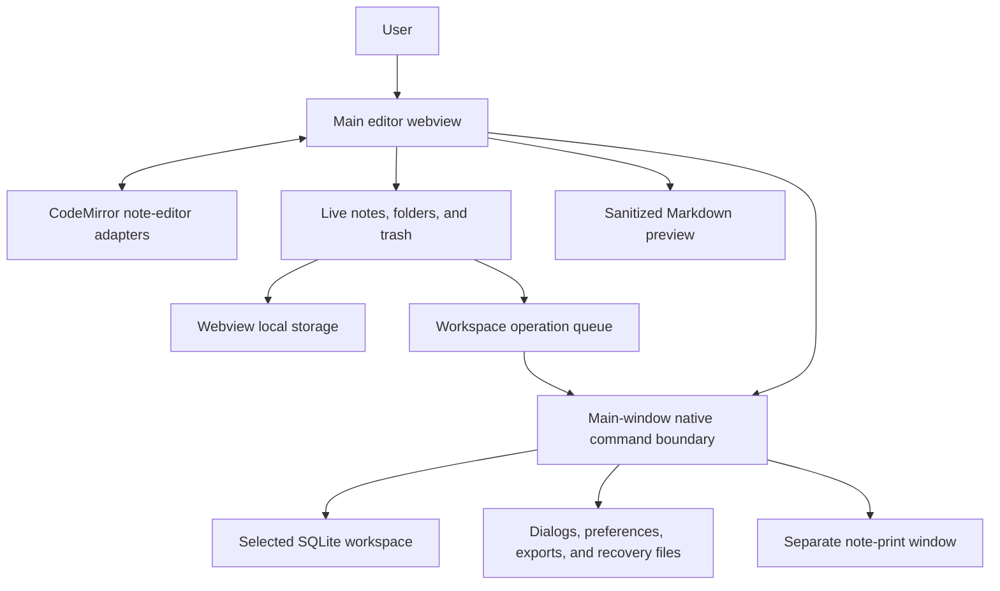
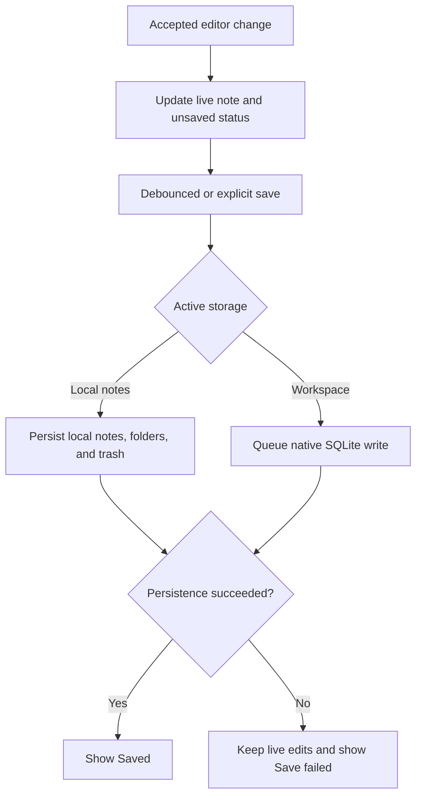
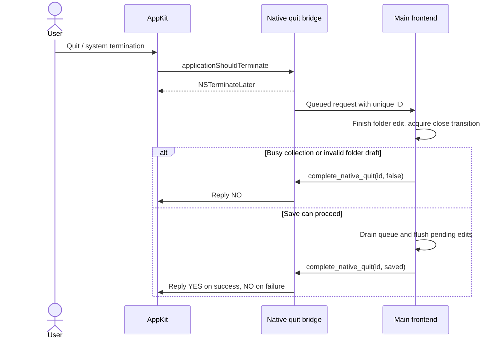
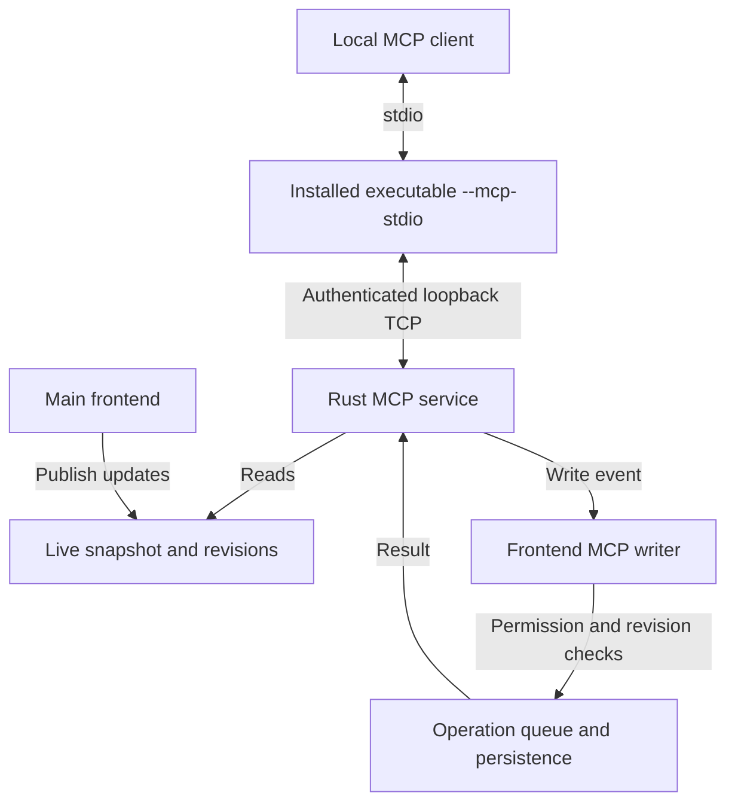
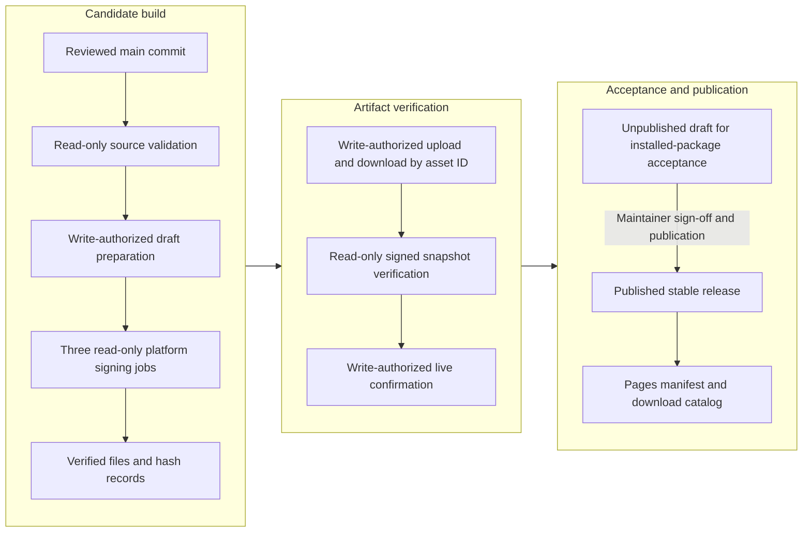

# Architecture and data flow

This guide describes the 1.0 source architecture. The diagrams use Mermaid and render on GitHub. They document implementation boundaries; package, OS, and upgrade acceptance are recorded separately through the [release checklist](release-checklist.md).

## Runtime and ownership

Scratchpad is a Tauri 2 desktop application. Its HTML/CSS/JavaScript frontend is bundled from `src/`, with no web service or JavaScript development server. CodeMirror 6, Marked, Highlight.js, and jsdiff are bundled for offline use. The Rust process provides native dialogs, file access, SQLite, preferences, update requests, printing, and the optional MCP bridge.

The frontend owns the live collection, selected notes, and unsaved edits. A workspace file is one storage destination for a collection; Local notes is another. Only the active collection is exposed to MCP. Print windows receive an in-memory snapshot of one note and have separate capabilities, with no workspace or collection commands.

| Area | Source and responsibility |
| --- | --- |
| App state, UI, transitions | [`src/main.js`](../src/main.js): collection selection, editor events, save scheduling, dialogs, and native event handlers |
| Editor adapter | [`src/note-editor.js`](../src/note-editor.js): CodeMirror sessions, selection/scroll, undo, read-only state, decorations, and compatibility with existing app handlers |
| Editing assistance | `src/editor-*.js`, [`markdown-insert.js`](../src/markdown-insert.js): lists, tables, pair completion, paste, indentation, bounded folding, and rendering schedules |
| Format, find, comparison | [`note-format.js`](../src/note-format.js), [`syntax-highlighting.js`](../src/syntax-highlighting.js), [`find.js`](../src/find.js), [`note-compare.js`](../src/note-compare.js) |
| Local storage/recovery | [`src/storage.js`](../src/storage.js), [`trash.js`](../src/trash.js), [`collection-backup.js`](../src/collection-backup.js) |
| Frontend MCP writes | [`src/mcp-writes.js`](../src/mcp-writes.js): permissions, live revisions, idempotent receipts, validation, and queued mutation/persistence |
| Native entry/commands | [`src-tauri/src/main.rs`](../src-tauri/src/main.rs), [`lib.rs`](../src-tauri/src/lib.rs), [`native_ipc_tests.rs`](../src-tauri/src/native_ipc_tests.rs) |
| Workspace access | [`src-tauri/src/workspace.rs`](../src-tauri/src/workspace.rs): selected-file grants and native preferences; SQLite commands are in `lib.rs` |
| Native file handling | [`file_export.rs`](../src-tauri/src/file_export.rs), [`backup.rs`](../src-tauri/src/backup.rs), [`recovery.rs`](../src-tauri/src/recovery.rs): staged/verified writes, safety copies, and local restore checkpoints |
| Native services | [`mcp.rs`](../src-tauri/src/mcp.rs), [`updates.rs`](../src-tauri/src/updates.rs), [`note_print.rs`](../src-tauri/src/note_print.rs), [`macos_quit.rs`](../src-tauri/src/macos_quit.rs) |
| Product documentation | [`README`](../README.md), [`welcome-note.js`](../src/welcome-note.js), Help in [`src/index.html`](../src/index.html), and [`site/`](../site/index.html) |

## Persistence and recovery

Local notes, folders, and trash use separate webview localStorage keys. Preferences, theme choices, and view settings are outside the collection backup format. Workspace collections use SQLite with ordered notes/folders and persistent trash; full collection writes use a transaction, while ordinary note saves can update one note.

Editor saves are debounced for 400 ms. Workspace saves and MCP writes are serialized through the frontend operation queue; queued saves capture live data when they execute. Ordinary local saves use synchronous localStorage writes and preserve trash before removing active notes. These are different persistence paths, not a single transaction spanning localStorage keys.

Opening a workspace stages its reads and initial seeding before publishing the new live collection. New, uninitialized workspaces can be seeded from readable notes/folders; unreadable local data and local trash are not copied. Startup uses a fresh welcome note if no readable local notes are available. Local folders are copied only when the local collection is not in recovery mode. Opening from the menu without available notes leaves the workspace empty. An initialized empty or trash-only workspace stays empty. Returning to Local notes reloads its separate collection. An import that completes during a switch waits for the outcome: cancellation/read/seed failure keeps the collection identity; a successful switch invalidates an old-collection import.

Backup saves the active collection as validated versioned JSON. Restore replaces that collection after confirmation; clear is local-only and requires `DELETE`. Both first save a verified independent safety backup under app data. Workspace replacement is transactional. Local replacement journals the previous raw local values in a durable native checkpoint; incomplete replacement rolls back, including on startup. Failed checkpoint recovery leaves local data read-only.

Unreadable local values are preserved. Manual recovery export and verified recovery archives are distinct from a restorable collection backup. See [Storage and privacy](../README.md#storage-and-privacy), [collection backup/restore](../README.md#collection-backup-and-restore), and [local-data recovery](../README.md#delete-and-recover-notes) for user actions.

All notes, workspace files, trash, backups, and recovery copies are unencrypted. The queue and transition locks coordinate one frontend only. There is no cross-process single-writer guarantee; use copied workspaces for development and concurrent-instance acceptance tests.

## Switching, closing, and macOS Quit

`beginCollectionTransition` finishes a pending folder edit, sets the busy flag, and updates app inertness and editor read-only state before asynchronous work. Invalid folder names visibly cancel the requested operation. Entry-point guards also reject queued/synthetic mutations and asynchronous callbacks. `endCollectionTransition` releases the owning transition after cancellation/failure. Backup, clear, and interrupted-restore recovery share this lifecycle; modal controls remain outside the inert app content.

Normal window closing waits for the operation queue and flushes saves before destroying the main window. Destruction also closes the print preview and exits. A failed save cancels closing and restores editing. macOS application Quit is a separate AppKit request and requires a deferred reply:

With no main window, AppKit is allowed to terminate immediately. If a live request receives no acknowledgement for 30 seconds, a parented native alert offers Keep Open, Quit Without Saving, or Cancel; timeout alone never discards data. Request IDs reject stale acknowledgements after cancellation. Native cancellation/failure releases the frontend's exact close transition. A normal close already in progress leaves the native watchdog armed. Installation of the macOS hook logs failure and allows startup if it cannot safely install.

Force Quit, crashes, power loss, and another process's writes remain outside these save/close guarantees. Actual system restart/logout/shutdown and final signed-package behavior still require native acceptance.

## MCP boundary

The stdio subprocess does not load note storage or create an editor window. It reads the profile's token and relays to the running editor at `127.0.0.1:39393`; this is not HTTP. The fixed port is shared across profiles, while token locations are profile-specific. Only one app can enable agent access at a time.

Access is off on launch. Every time it starts, five reads are enabled and eight writes disabled. Permissions apply to all connected clients; changes are checked again before queued writes start. Reads use snapshots that include unsaved edits. Existing-item writes require live revisions; retry receipts prevent reapplying the same request. A successful collection change/replacement or restart invalidates the old collection ID. Canceled/failed switch attempts do not.

The token and local authentication are not protection from arbitrary processes running as the same user. Clients may send returned content to their model provider. Full schemas, limits, retry semantics, and client examples are in the [MCP reference](mcp.md).

## Rendering and native command boundaries

- Markdown is parsed and allowlist-sanitized locally. Preview, HTML export, and print share restrictions on scripts, unsafe links, and remote/local-file images; supported embedded raster images are allowed. Preview links open externally through the scoped opener.
- Main-window native commands require the main window and local app origin. The print window has a smaller capability set. Native workspace grants come from user selection or validated native preference restoration; arbitrary frontend paths are insufficient.
- Native exports stage and verify files before replacement and cannot overwrite workspaces opened during the current app session. New Unix workspace/recovery files use owner-only permissions; existing workspace sharing permissions are retained.
- Optional update checks use Rust HTTP requests for the public release manifest; they send no notes or workspace data. Automatic checks are off by default. There is no in-app download/install updater.

See [SECURITY.md](../SECURITY.md), [`capabilities/`](../src-tauri/capabilities/default.json), and [`permissions/`](../src-tauri/permissions/editor-commands.toml) for the policy and enforced command surface.

## Development, release, and website

Plain `tauri dev` and local builds use the development identity and `scratchpad-dev`. The release workflow applies `tauri.release.conf.json` and platform signing overrides, retaining the historical production identifier and `scratchpad` executable for upgrade continuity. Separate profiles isolate local data and preferences, not deliberately shared workspace files or the MCP port.

The workflow does not publish automatically. No write-authorized release job installs npm dependencies. Files, hashes, asset IDs, release ID, source commit, and workflow run are checked across the handoff. See the [release checklist](release-checklist.md) and signing guides for the authoritative procedure and failed-run recovery.

The [Pages workflow](../.github/workflows/pages.yml) stages `site/` plus `images/`, generates a manifest from published GitHub releases, and deploys static assets. The website and current desktop updater prefer a published stable release; the beta fallback/legacy alias serves pre-1.0 clients. Drafts are never advertised. The [transition guide](transition-to-1.0.md) explains the retained identifier and discovery compatibility.

The website matches its selected OS/CPU to that manifest. Reliable 64-bit Client Hints can suggest x64/ARM64; missing hints require an explicit choice, and macOS uses Universal. User choices override asynchronous detection. Unavailable architectures never fall back to another CPU's installer. The full catalog preserves each architecture's formats, URLs and checksums. See [download selection](download-selection.md).

## Validation boundaries

`npm run check` covers version consistency, JavaScript syntax, unit tests, and JSDOM integration tests using stubbed native calls. Rust tests cover native logic/IPC, SQLite, export verification, and loopback MCP behavior. CI adds Windows workspace/installer-transition checks and macOS quit formatting, Clippy, and native tests.

These checks do not substitute for browser-downloaded signed installers, native Intel testing, OS quit/restart behavior, screen-reader/IME testing, or real v0.8.2 upgrade/data continuity. Record those against the exact signed artifacts in the linked release acceptance issues.
