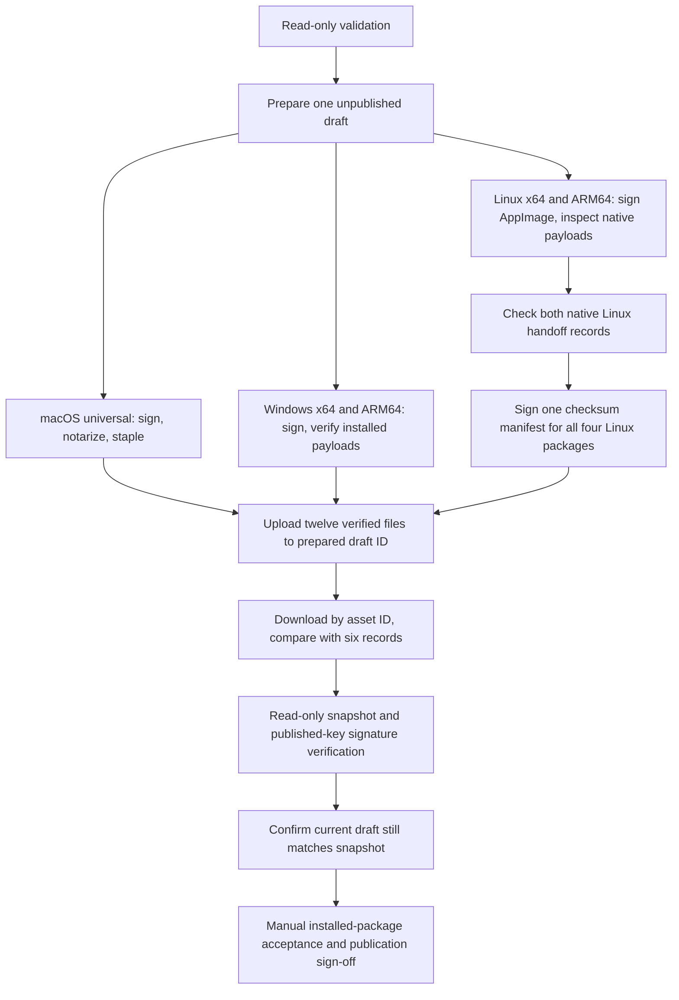

# ARM64 in Stable Release

The Stable Release workflow prepares one unpublished candidate from one reviewed `main` commit, version, workflow run and draft release ID. All builds select `tauri.release.conf.json`: product **Scratchpad**, executable `scratchpad` / `scratchpad.exe`, and the existing production data identity `io.github.crims0n.scratchpad.beta`. Development signing probes remain isolated under `.dev`.

| Runner | Native Rust target | Canonical suffixes after `Scratchpad_<version>_` | Verification record |
| --- | --- | --- | --- |
| macOS | Universal Apple Silicon + Intel | `universal.dmg`, `universal.app.tar.gz` | `macos-universal.json` |
| `windows-latest` | `x86_64-pc-windows-msvc` | `x64-setup.exe`, `x64_en-US.msi` | `windows-x64.json` |
| `windows-11-arm` | `aarch64-pc-windows-msvc` | `arm64-setup.exe`, `arm64_en-US.msi` | `windows-arm64.json` |
| `ubuntu-22.04` | `x86_64-unknown-linux-gnu` | `amd64.AppImage`, `amd64.deb` | `linux-x64.json` |
| `ubuntu-22.04-arm` | `aarch64-unknown-linux-gnu` | `aarch64.AppImage`, `arm64.deb` | `linux-arm64.json` |

Linux adds exactly one `SHA256SUMS` / `SHA256SUMS.asc` pair and one `linux-checksums.json` record. The complete draft has **ten installers and two checksum files**, authenticated by six schema-v2 verification records. Each record includes platform/architecture, candidate ID, version, commit, run ID and exact file sizes/hashes. There is no ambiguous platform-wide Windows/Linux record, and no per-build checksum pair.

Build/checksum jobs use the protected `release-signing` environment and repository read permission. Only dependency-free preparation, upload and final live confirmation have repository write access. Windows retains publisher/chain/timestamp checks, native payload architecture checks and its documented x86 NSIS uninstaller exception; its x64 signing tools run under emulation on the ARM runner. The shared Linux inspector verifies both packaged applications, every regular bundled ELF file (including shared libraries/helpers), and DEB architecture metadata on each native runner. The shared toolchain guard requires an exact Rust host and native Node.js architecture; a single failing command fails the Windows step too.

Linux signing uses an explicitly selected temporary keyring in both signing workflows, with agent/socket/keyring cleanup even on failure. Configuration updates preserve existing contents and are idempotent. The checksum job checks both native build handoffs **before importing the key**, cryptographically verifies both embedded AppImage signatures against only the published key, signs the four-package manifest and proves modified manifests/packages are rejected. Upload and snapshot verification each verify the downloaded checksum signature against only the checked-in public key.

Artifact and evidence names include architecture; the checksum job publishes only its checksum pair, so artifact merging cannot overwrite a native package or another manifest. Handoffs reject missing/extra files, wrong candidate/run, changed bytes and duplicated architecture records. Staging rejects unexpected installer names. Final draft checks still reject missing, unexpected, duplicate or changed assets, retargeting and publication during verification. Use the [release checklist](release-checklist.md) for rerun/recovery rules; never mix different runs' artifacts.

## Publication prerequisites

This pipeline does not publish a release or change the existing v1.0.0 assets. Manifest generation recognizes ARM64 packages while retaining the existing stable/legacy update aliases and primary flags. The [website chooser](download-selection.md) filters by selected platform/architecture and prefers EXE/AppImage within that matching set, including non-primary ARM64 records. The signed v1.1.0 production release, deployed-catalog verification and maintainer-confirmed manual acceptance are recorded in [#132](https://github.com/crims0n/scratchpad/issues/132) and the [v1.1.0 release record](releases/1.1.0.md).

Before publishing ARM64, record Linux and Windows ARM64 hardware/OS, each installer format, candidate commit and package hashes; verify install, launch, edit/save/restart, MCP through the installed executable, and uninstall. Define/test supported upgrades and architecture/format switching with backed-up notes, preferences, workspaces and MCP configuration. Do not infer these results from successful compilation, extraction, emulated signing tools or the development-package signing proof.
